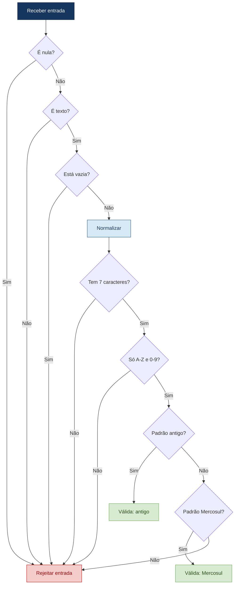
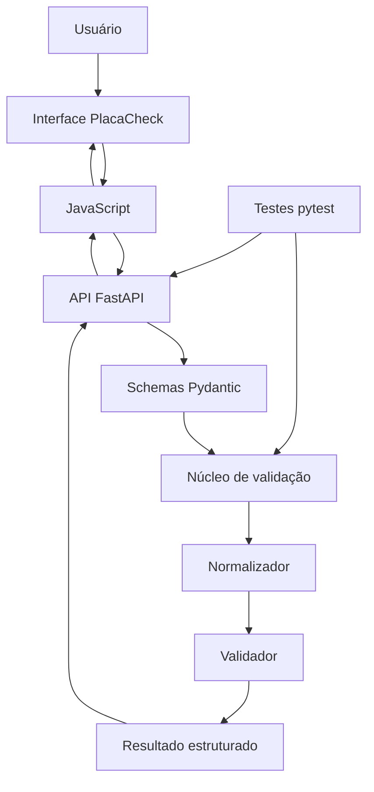
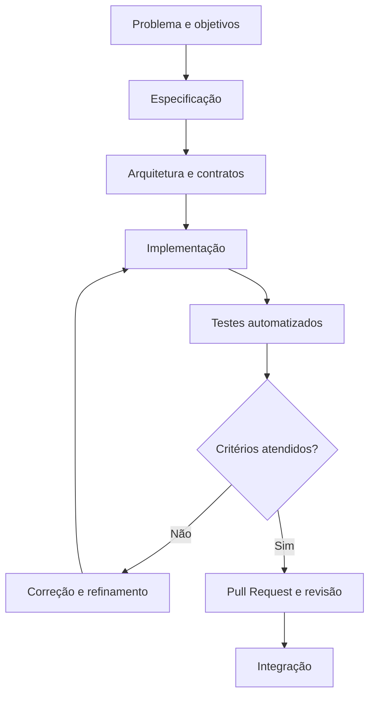

# BootCamp3 — Validador de Placas Brasileiras

API e interface web para validação de placas veiculares brasileiras nos padrões **antigo** e **Mercosul**, desenvolvidas em Python com abordagem *Spec-Driven Development* (SDD).

O projeto conta com uma interface visual para facilitar a utilização do sistema, além de uma API HTTP documentada, núcleo de validação independente.

---

## Guia rápido — Como executar o projeto

A maneira recomendada de executar o projeto é utilizando Docker Compose. Assim, não é necessário instalar manualmente as dependências Python.

### 1. Pré-requisitos

- Git instalado.
- Docker Desktop instalado e em execução.
- Conexão com a internet na primeira execução, para baixar a imagem e as dependências necessárias.

### 2. Clonar o repositório

Abra o terminal e execute:

```bash
git clone https://github.com/0GabrielF0/BootCamp3.git
cd BootCamp3
```

### 3. Iniciar a aplicação

Execute:

```bash
docker compose up --build -d
```

O Docker irá construir a imagem e iniciar a aplicação.

### 4. Acessar o sistema

Depois que o contêiner estiver iniciado, acesse pelo navegador:

| Recurso | Endereço |
|---|---|
| Interface visual PlacaCheck | http://localhost:8000/ |
| Documentação interativa da API | http://localhost:8000/docs |
| Verificação de disponibilidade | http://localhost:8000/health |

Na interface PlacaCheck, informe uma placa brasileira e clique em **Validar placa** para visualizar o resultado.

### 5. Executar os testes automatizados

Para executar a suíte de testes no ambiente Docker:

```bash
docker compose run --rm tests
```

### 6. Encerrar a aplicação

Quando terminar de utilizar o sistema:

```bash
docker compose down
```

---

## Integrantes

- **Adler Murga Ferreira** — RA: 22511624
- **Alexandre Henrique Paiva Rocha** — RA: 22451424
- **Arthur Gabriel da Silva Barbosa** — RA: 22500598
- **Gabriel Francisco Pires de Assis** — RA: 22408417
- **Jean de Almeida Brito** — RA: 22612228
- **José Rafael de Lucena Martini** — RA: 22610479

---

## 1. Visão geral

O Validador de Placas Brasileiras recebe uma placa informada pelo usuário, normaliza sua representação e verifica se ela corresponde a um dos formatos definidos na especificação do projeto.

O sistema disponibiliza duas formas de utilização:

- **Interface web:** aplicação visual desenvolvida com HTML, CSS e JavaScript, permitindo inserir placas e visualizar os resultados da validação.
- **API HTTP:** serviço desenvolvido com FastAPI, responsável por receber as requisições e retornar os resultados estruturados.

São considerados dois padrões:

| Padrão | Exemplo |
|---|---|
| Antigo | `ABC-1234` |
| Mercosul | `ABC1D23` |

O sistema retorna um resultado estruturado com a validade da placa, sua representação normalizada, o padrão identificado e uma mensagem explicativa. Para entradas inválidas, informa o motivo da rejeição conforme as regras definidas.

O projeto utiliza **Spec-Driven Development (SDD)**, mantendo a especificação como referência para a arquitetura, implementação e testes automatizados.

## 2. Objetivos e escopo

### Funcionalidades implementadas

- Recebimento de placas por meio da interface web e da API HTTP.
- Normalização de espaços externos e letras minúsculas.
- Aceitação do padrão antigo com ou sem hífen separador.
- Validação dos padrões antigo e Mercosul.
- Identificação do padrão reconhecido.
- Retorno estruturado para resultados válidos e inválidos.
- Identificação de motivos de rejeição.
- Validação do corpo da requisição e tratamento estruturado de erros.
- Interface visual responsiva para interação com o usuário.
- Comunicação entre a interface web e a API.
- Endpoint de saúde da aplicação.
- Testes automatizados para o núcleo, a API e a entrega da interface.

### Fora do escopo

- Consulta de proprietários ou dados pessoais.
- Consulta de RENAVAM.
- Integração com DETRAN.
- Consulta a bancos de dados de veículos.
- Reconhecimento de placas por imagem ou câmera.

A validação verifica apenas a conformidade do texto informado com os formatos estabelecidos. Ela não comprova a existência ou a regularidade de um veículo.

## 3. Tecnologias utilizadas

- **Python** — linguagem de implementação.
- **FastAPI** — exposição das funcionalidades por API HTTP.
- **Pydantic** — validação dos dados recebidos pela API.
- **HTML** — estrutura da interface web.
- **CSS** — estilização e responsividade da interface.
- **JavaScript** — interação com o usuário e comunicação com a API.
- **pytest** — execução dos testes automatizados.
- **Docker** — padronização da execução do ambiente.
- **Git e GitHub** — controle de versão, colaboração e revisão de código.

## 4. Arquitetura

A aplicação separa as regras de negócio da camada HTTP e da interface visual. O núcleo de validação pode ser executado independentemente da API, facilitando testes, manutenção e evolução.

A interface web é servida pela própria aplicação FastAPI, sem necessidade de executar um servidor separado para o front-end.

### Componentes principais

| Componente | Responsabilidade |
|---|---|
| `app/core/normalizador.py` | Normaliza a entrada conforme as regras definidas. |
| `app/core/resultado.py` | Define os tipos de resultado, padrões e motivos de rejeição. |
| `app/core/validador.py` | Aplica as regras de validação das placas. |
| `app/main.py` | Configura a aplicação FastAPI, os endpoints e a disponibilização da interface. |
| `app/schemas.py` | Define os modelos de entrada e saída da API. |
| `app/static/index.html` | Estrutura da interface web PlacaCheck. |
| `app/static/style.css` | Estilização visual e adaptação da interface para diferentes telas. |
| `app/static/script.js` | Controla a interação do usuário e a comunicação com a API. |
| `tests/test_validator.py` | Testa o núcleo de normalização e validação. |
| `tests/test_api.py` | Testa os endpoints, os contratos HTTP e a entrega da interface. |

### Fluxo de validação



### Diagrama de arquitetura



## 5. Contrato da API

A aplicação disponibiliza endpoints HTTP para interação e consulta.

### `GET /`

Disponibiliza a interface web PlacaCheck, permitindo que o usuário utilize o sistema diretamente pelo navegador.

Endereço:

```text
http://localhost:8000/
```

### `GET /health`

Verifica a disponibilidade da API.

Exemplo de resposta:

```json
{
  "status": "ok"
}
```

### `POST /validar`

Recebe uma placa para validação.

Exemplo de requisição:

```json
{
  "placa": "ABC-1234"
}
```

Exemplo de resposta para uma placa válida:

```json
{
  "valida": true,
  "placa_normalizada": "ABC1234",
  "padrao": "antigo",
  "motivo": null,
  "mensagem": "Placa válida no padrão antigo."
}
```

Exemplo de resposta para uma placa inválida:

```json
{
  "valida": false,
  "placa_normalizada": null,
  "padrao": null,
  "motivo": "CARACTERE_INVALIDO",
  "mensagem": "A placa contém caracteres não permitidos. Use apenas letras de A a Z e dígitos de 0 a 9."
}
```

Entradas inválidas do ponto de vista das regras de negócio retornam um resultado de validação. Requisições com corpo ou tipos de dados incompatíveis são tratadas como erros HTTP de validação.


## 6. Instalação e execução local

Além do Docker, também é possível executar o projeto diretamente em um ambiente Python.

### Pré-requisitos

- Python 3.12 (mesma versão do Docker e do CI).
- Git.
- Terminal ou VS Code.

### Clonar o repositório

```bash
git clone https://github.com/0GabrielF0/BootCamp3.git
cd BootCamp3
```

### Criar um ambiente virtual

No Windows:

```powershell
python -m venv .venv
.venv\Scripts\Activate.ps1
```

### Instalar dependências

```powershell
python -m pip install -r requirements.txt
```

### Iniciar a aplicação

```powershell
python -m uvicorn app.main:app --reload
```

Acesse no navegador:

- Interface visual: http://127.0.0.1:8000/

- Documentação da API: http://127.0.0.1:8000/docs
- Verificação de saúde: http://127.0.0.1:8000/health

Para encerrar o servidor, pressione `Ctrl + C` no terminal.

## 7. Execução dos testes

Com as dependências instaladas, execute:

```powershell
python -m pytest -v
```

Os testes verificam regras de normalização, formatos válidos e inválidos, motivos de rejeição, endpoints e tratamento de requisições.

**Resultado da última execução registrada (2026-10-31):** 56 testes aprovados, 0 falhas, cobertura de 100% em `app/core`. Execução local, fora do Docker, com Python 3.12; log em [`logs_testes_local.txt`](logs_testes_local.txt).

**Última execução registrada no Docker (2026-10-25):** 50 testes aprovados, antes dos testes adicionados na spec v2.0; log em [`logs_testes_final.txt`](logs_testes_final.txt).


## 8. Execução com Docker

O projeto utiliza Docker para padronizar o ambiente e permitir que a aplicação seja executada de maneira reproduzível em diferentes máquinas.

O `Dockerfile` utiliza a imagem `python:3.12-slim`, e o `compose.yaml` configura os serviços da aplicação e dos testes automatizados.

### Iniciar a aplicação

```powershell
docker compose up --build -d
```

A interface web fica disponível em:

```text
http://localhost:8000/
```

A documentação da API fica disponível em:

```text
http://localhost:8000/docs
```

A verificação de saúde pode ser acessada em:

```text
http://localhost:8000/health
```

### Executar os testes no Docker

```powershell
docker compose run --rm tests
```


**Verificação anterior da API (2026-10-25):**

```text
$ curl http://127.0.0.1:8000/health
{"status":"ok"}

$ curl -X POST http://127.0.0.1:8000/validar -H "Content-Type: application/json" -d '{"placa":"abc1d23"}'
{"valida":true,"placa_normalizada":"ABC1D23","padrao":"mercosul","motivo":null,"mensagem":"Placa válida no padrão Mercosul."}
```

O resultado acima registra a verificação anterior da API. A interface visual deve ser conferida também no ambiente Docker após sua integração.

A última execução dos testes no Docker está versionada em [`logs_testes_final.txt`](logs_testes_final.txt). O roteiro completo de demonstração está em [`docs/DEMO.md`](docs/DEMO.md).

## 9. Spec-Driven Development (SDD)

Documentos do fluxo SDD:

- [`docs/spec.md`](docs/spec.md) — especificação técnica.
- [`docs/components.md`](docs/components.md) — decomposição em componentes.
- [`docs/spec-changelog.md`](docs/spec-changelog.md) — refinamentos da especificação.
- [`docs/refinamento-testes-erros-respecificacao.md`](docs/refinamento-testes-erros-respecificacao.md) — erros lógicos e loop de re-especificação.
- [`docs/ERROS.md`](docs/ERROS.md) — registro dos erros lógicos do ciclo (E-01 a E-07).
- [`docs/DEMO.md`](docs/DEMO.md) — roteiro de demonstração da aplicação.
- [`docs/sprints.md`](docs/sprints.md) — ciclos de trabalho, tarefas e responsáveis, a partir do histórico do GitHub.
- [`docs/relatorio-tecnico-etico.md`](docs/relatorio-tecnico-etico.md) — análise comparativa e ético-técnica do uso de IA.
- [`CLAUDE.md`](CLAUDE.md) / [`AGENTS.md`](AGENTS.md) — regras e contexto para os agentes de IA.

O desenvolvimento é orientado por especificações versionadas. As decisões de implementação estão alinhadas aos requisitos funcionais, não funcionais, regras de negócio e contratos documentados.

### Fluxo adotado



Documentos de referência do projeto:

- `docs/spec.md` — especificação funcional e regras de negócio.
- `docs/components.md` — arquitetura e responsabilidades dos componentes.
- `docs/spec-changelog.md` — histórico e justificativas das alterações na especificação.

## 10. ADRs — Registros de Decisões Arquiteturais

Os ADRs (*Architecture Decision Records*) documentam as principais decisões técnicas, suas justificativas e consequências. Cada decisão fica versionada em um arquivo próprio em [`docs/adr/`](docs/adr/).

| ADR | Decisão | Status |
|---|---|---|
| [ADR-001](docs/adr/001-python-como-linguagem-principal.md) | Python como linguagem principal | Aceita |
| [ADR-002](docs/adr/002-fastapi-para-a-interface-http.md) | FastAPI para a interface HTTP | Aceita |
| [ADR-003](docs/adr/003-separacao-entre-nucleo-e-api.md) | Separação entre núcleo e API | Aceita |
| [ADR-004](docs/adr/004-expressoes-regulares-para-os-formatos-de-placas.md) | Expressões regulares para os formatos de placas | Aceita |
| [ADR-005](docs/adr/005-pytest-como-ferramenta-de-testes.md) | pytest como ferramenta de testes | Aceita |
| [ADR-006](docs/adr/006-git-com-branches-e-pull-requests.md) | Git com branches e Pull Requests | Aceita |
| [ADR-007](docs/adr/007-docker-para-padronizacao-do-ambiente.md) | Docker para padronização do ambiente | Aceita |

## 11. Controle de versão e colaboração

O projeto adota o fluxo:

```text
feature/*  → main
```

- **`main`:** versão principal e estável.
- **`feature/*`:** desenvolvimento de funcionalidades.

As contribuições devem ser feitas por branches e Pull Requests, com descrição das alterações e revisão por outro integrante. A branch `main` respeita as regras de proteção configuradas no repositório.

## 12. Relato de experiência do grupo

O desenvolvimento do projeto permitiu aplicar práticas de especificação, implementação incremental, testes automatizados e controle de versão colaborativo.

A abordagem SDD ajudou a transformar regras de negócio em comportamentos verificáveis, incluindo a normalização de entradas, a distinção entre os padrões de placas e a identificação estruturada de motivos de rejeição.

A separação do núcleo de validação da API favoreceu a organização do código e a testabilidade. Os testes também ajudaram a identificar e corrigir divergências entre o comportamento esperado e a implementação, incluindo o tratamento de métodos HTTP não permitidos.

O uso de Git e Pull Requests reforça a importância de preservar o histórico de alterações e revisar contribuições antes da integração. Durante o desenvolvimento, conflitos entre versões locais e remotas evidenciaram a necessidade de conferir o histórico das branches e resolver divergências cuidadosamente.

### Uso de inteligência artificial

A inteligência artificial foi utilizada como apoio à implementação, à revisão de código e correção de testes.

O uso de IA não substitui a responsabilidade dos integrantes pela correção, segurança e conformidade da solução com a especificação. As decisões técnicas e a aceitação das alterações continuam sob responsabilidade do grupo.


## 13. Status do projeto

**Implementação principal:** núcleo de validação, API e interface visual implementados.

- [x] Núcleo de normalização e validação.
- [x] API com endpoints principais.
- [x] Respostas estruturadas de validação.
- [x] Testes automatizados: 56 aprovados na última execução registrada.
- [x] Cobertura de 100% no núcleo na última execução registrada.
- [x] Pipeline de CI no GitHub Actions.
- [x] Configuração de execução com Docker Compose.
- [x] ADRs em arquivos individuais ([`docs/adr/`](docs/adr/)).
- [x] Instruções para agentes de IA ([`CLAUDE.md`](CLAUDE.md), [`AGENTS.md`](AGENTS.md)).
- [x] Interface web PlacaCheck com HTML, CSS e JavaScript, incorporada à spec v2.0.


---

**Projeto acadêmico — Validador de Placas Brasileiras**