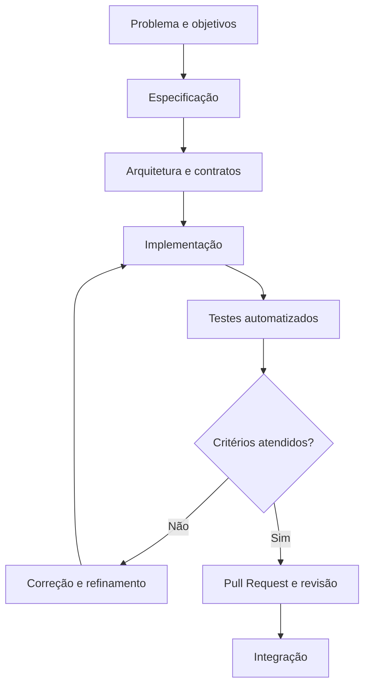

# Validador de Placas Brasileiras

API para validação de placas veiculares brasileiras nos padrões **antigo** e **Mercosul**, desenvolvida em Python com abordagem *Spec-Driven Development* (SDD).

## Integrantes

- **Adler Murga Ferreira** — RA: 22511624
- **Alexandre Henrique Paiva Rocha** — RA: 22451424
- **Arthur Gabriel da Silva Barbosa** — RA: 22500598
- **Gabriel Francisco Pires de Assis** — RA: 22408417
- **Jean de Almeida Brito** — RA: 22612228
- **José Rafael de Lucena Martini** — RA: 22610479

---

## 1. Visão geral

O Validador de Placas Brasileiras recebe uma placa informada pelo usuário, normaliza sua representação e verifica se ela corresponde a um dos formatos definidos na especificação do projeto.

São considerados dois padrões:

| Padrão | Exemplo |
|---|---|
| Antigo | `ABC-1234` |
| Mercosul | `ABC1D23` |

O sistema retorna um resultado estruturado com a validade da placa, sua representação normalizada, o padrão identificado e uma mensagem explicativa. Para entradas inválidas, informa o motivo da rejeição conforme as regras definidas.

O projeto utiliza **Spec-Driven Development (SDD)**, mantendo a especificação como referência para a arquitetura, implementação e testes automatizados.

## 2. Objetivos e escopo

### Funcionalidades implementadas

- Recebimento de placas por meio de uma API HTTP.
- Normalização de espaços externos e letras minúsculas.
- Aceitação do padrão antigo com ou sem hífen separador.
- Validação dos padrões antigo e Mercosul.
- Identificação do padrão reconhecido.
- Retorno estruturado para resultados válidos e inválidos.
- Identificação de motivos de rejeição.
- Validação do corpo da requisição e tratamento estruturado de erros.
- Endpoint de saúde da aplicação.
- Testes automatizados para o núcleo e a API.

### Fora do escopo

- Consulta de proprietários ou dados pessoais.
- Consulta de RENAVAM.
- Integração com DETRAN.
- Consulta a bancos de dados de veículos.
- Reconhecimento de placas por imagem ou câmera.

A validação verifica apenas a conformidade do texto informado com os formatos estabelecidos. Ela não comprova a existência ou a regularidade de um veículo.

## 3. Tecnologias utilizadas

- **Python** — linguagem de implementação.
- **FastAPI** — exposição das funcionalidades por API HTTP.
- **Pydantic** — validação dos dados recebidos pela API.
- **pytest** — execução dos testes automatizados.
- **Docker** — previsto para padronizar a execução do ambiente.
- **Git e GitHub** — controle de versão, colaboração e revisão de código.

## 4. Arquitetura

A aplicação separa as regras de negócio da camada HTTP. O núcleo de validação pode ser executado independentemente da API, facilitando testes, manutenção e evolução.

### Componentes principais

| Componente | Responsabilidade |
|---|---|
| `app/core/normalizador.py` | Normaliza a entrada conforme as regras definidas. |
| `app/core/resultado.py` | Define os tipos de resultado, padrões e motivos de rejeição. |
| `app/core/validador.py` | Aplica as regras de validação das placas. |
| `app/main.py` | Configura a aplicação FastAPI e seus endpoints. |
| `app/schemas.py` | Define os modelos de entrada e saída da API. |
| `app/validator.py` | Mantém uma interface de compatibilidade com o caminho antigo do validador. |
| `tests/test_validator.py` | Testa o núcleo de normalização e validação. |
| `tests/test_api.py` | Testa os endpoints e os contratos HTTP. |

### Diagrama de arquitetura

flowchart TD
    A["Cliente HTTP"] --> B["API FastAPI<br/>app/main.py"]
    B --> C["Schemas<br/>Pydantic"]
    C --> D["Núcleo de validação"]
    D --> E["Normalizador"]
    E --> F["Validador"]
    F --> G["Resultado estruturado"]
    G --> H["Resposta JSON"]
    H --> A

    T["Testes pytest"] --> D
    T --> B

    style D fill:#17365D,color:#FFFFFF,stroke:#10243A
    style F fill:#1F4E79,color:#FFFFFF,stroke:#10243A
    style G fill:#D9EAF7,color:#17365D,stroke:#1F4E79

### Fluxo de validação

flowchart TD
    A["Receber entrada"] --> B{"É nula?"}
    B -- Sim --> X["Rejeitar entrada"]
    B -- Não --> C{"É texto?"}
    C -- Não --> X
    C -- Sim --> D{"Está vazia?"}
    D -- Sim --> X
    D -- Não --> E["Normalizar"]
    E --> F{"Tem 7 caracteres?"}
    F -- Não --> X
    F -- Sim --> G{"Só A-Z e 0-9?"}
    G -- Não --> X
    G -- Sim --> H{"Padrão antigo?"}
    H -- Sim --> I["Válida: antigo"]
    H -- Não --> J{"Padrão Mercosul?"}
    J -- Sim --> K["Válida: Mercosul"]
    J -- Não --> X

    style A fill:#17365D,color:#FFFFFF,stroke:#10243A
    style E fill:#D9EAF7,color:#17365D,stroke:#1F4E79
    style I fill:#D9EAD3,color:#274E13,stroke:#6AA84F
    style K fill:#D9EAD3,color:#274E13,stroke:#6AA84F
    style X fill:#F4CCCC,color:#990000,stroke:#CC0000
    
## 5. Contrato da API

### `GET /`

Retorna informações básicas sobre a aplicação.

### `GET /health`

Verifica a disponibilidade da API.

Exemplo de resposta:

```json
{
  "status": "ok"
}
```

### `POST /validar`

Recebe uma placa para validação.

Exemplo de requisição:

```json
{
  "placa": "ABC-1234"
}
```

Exemplo de resposta para uma placa válida:

```json
{
  "valida": true,
  "placa_normalizada": "ABC1234",
  "padrao": "antigo",
  "motivo": null,
  "mensagem": "Placa válida no padrão antigo."
}
```

Exemplo de resposta para uma placa inválida:

```json
{
  "valida": false,
  "placa_normalizada": null,
  "padrao": null,
  "motivo": "CARACTERE_INVALIDO",
  "mensagem": "A placa contém caracteres não permitidos. Use apenas letras de A a Z e dígitos de 0 a 9."
}
```

Entradas inválidas do ponto de vista das regras de negócio retornam um resultado de validação. Requisições com corpo ou tipos de dados incompatíveis são tratadas como erros HTTP de validação.
 

## 6. Instalação e execução local

### Pré-requisitos

- Python 3.11 ou compatível com as dependências do projeto.
- Git.
- Terminal ou VS Code.

### Clonar o repositório

```bash
git clone https://github.com/0GabrielF0/BootCamp3.git
cd BootCamp3
```

### Criar um ambiente virtual

No Windows:

```powershell
python -m venv .venv
.venv\Scripts\Activate.ps1
```

### Instalar dependências

```powershell
python -m pip install -r requirements.txt
```

### Iniciar a API

```powershell
python -m uvicorn app.main:app --reload
```

Acesse no navegador:

- API e documentação: http://127.0.0.1:8000/docs
- Verificação de saúde: http://127.0.0.1:8000/health

Para encerrar o servidor, pressione `Ctrl + C` no terminal.

## 7. Execução dos testes

Com as dependências instaladas, execute:

```powershell
python -m pytest -v
```

Os testes verificam regras de normalização, formatos válidos e inválidos, motivos de rejeição, endpoints e tratamento de requisições.

**Resultado registrado durante o desenvolvimento:** 47 testes passaram, sem falhas, em execução local. Foi exibido um aviso de depreciação relacionado ao `TestClient` e à integração com HTTPX. Esse aviso não impediu a execução dos testes.


### Cobertura de código

A especificação prevê cobertura mínima de 90% para o núcleo. Para medir a cobertura, instale `pytest-cov`, caso ainda não esteja listado nas dependências:

```powershell
python -m pip install pytest-cov
python -m pytest --cov=app.core --cov-report=term-missing
```

O percentual obtido deve ser registrado após a execução.

## 8. Execução com Docker

O projeto prevê a padronização do ambiente por meio de Docker, de modo que a API possa ser executada de maneira reproduzível.

Quando o `Dockerfile` e o `compose.yaml` ou `docker-compose.yml` estiverem configurados e verificados, a execução prevista será:

```powershell
docker compose up --build
```

A API deverá ficar disponível em `http://127.0.0.1:8000/docs`.


## 9. Spec-Driven Development (SDD)

O desenvolvimento é orientado por especificações versionadas. As decisões de implementação estão alinhadas aos requisitos funcionais, não funcionais, regras de negócio e contratos documentados.

Fluxo adotado:



Documentos de referência do projeto:

- `docs/spec.md` — especificação funcional e regras de negócio.
- `docs/components.md` — arquitetura e responsabilidades dos componentes.
- `docs/spec-changelog.md` — histórico e justificativas das alterações na especificação.

As alterações nas especificações devem ser revisadas e versionadas, com registro do motivo da mudança e de seu impacto nos testes.

## 10. ADRs — Registros de Decisões Arquiteturais

Os ADRs (*Architecture Decision Records*) documentam as principais decisões técnicas, suas justificativas e consequências. Os registros abaixo consolidam as decisões refletidas na implementação atual; devem ser versionados em `docs/adr/` e revisados pelo grupo.

### ADR-001 — Python como linguagem principal

**Decisão:** utilizar Python.

**Justificativa:** permite implementar regras de validação com expressões regulares, manter o núcleo simples e utilizar ferramentas de testes automatizados.

**Consequências:** a equipe precisa manter as dependências e a versão do ambiente documentadas.

### ADR-002 — FastAPI para a interface HTTP

**Decisão:** expor a validação por meio de uma API FastAPI.

**Justificativa:** permite definir endpoints, validar requisições e gerar documentação OpenAPI.

**Consequências:** a camada HTTP deve permanecer separada das regras centrais de negócio.

### ADR-003 — Separação entre núcleo e API

**Decisão:** manter a normalização, os tipos de resultado e a validação em `app/core/`.

**Justificativa:** reduz o acoplamento com o framework web e permite testar as regras sem depender de requisições HTTP.

**Consequências:** os módulos centrais devem evitar dependências de FastAPI, Pydantic e Starlette.

### ADR-004 — Expressões regulares para os formatos de placas

**Decisão:** utilizar expressões regulares para verificar os padrões antigo e Mercosul.

**Justificativa:** os formatos definidos possuem sequências de letras e números que podem ser representadas por padrões explícitos.

**Consequências:** mudanças nas regras oficiais ou na especificação exigem revisão dos padrões e dos testes correspondentes.

### ADR-005 — pytest como ferramenta de testes

**Decisão:** utilizar pytest para os testes automatizados do núcleo e da API.

**Justificativa:** permite verificar comportamentos válidos, entradas inválidas e contratos HTTP de forma repetível.

**Consequências:** as alterações devem ser acompanhadas por testes relacionados aos requisitos e regras afetados.

### ADR-006 — Git com branches e Pull Requests

**Decisão:** utilizar `main`, `develop` e branches `feature/*`, com integração por Pull Requests.

**Justificativa:** favorece revisão por pares, rastreabilidade das alterações e proteção da versão principal.

**Consequências:** commits de funcionalidades devem passar pelo fluxo de revisão estabelecido pelo grupo.

### ADR-007 — Docker para padronização do ambiente

**Decisão prevista:** utilizar Docker e Docker Compose para padronizar a execução da aplicação.

**Justificativa:** reduzir diferenças entre ambientes de desenvolvimento e execução.

**Consequências:** a decisão só estará operacionalmente validada quando a imagem for construída, a aplicação iniciar pelo Compose e os endpoints e testes relevantes forem verificados no ambiente conteinerizado.

## 11. Controle de versão e colaboração

O projeto adota o fluxo:

```text
feature/* → develop → main
```

- **`main`:** versão principal e estável.
- **`develop`:** integração das funcionalidades aprovadas.
- **`feature/*`:** desenvolvimento de funcionalidades.

As contribuições devem ser feitas por branches e Pull Requests, com descrição das alterações e revisão por outro integrante. A branch `main` respeita as regras de proteção configuradas no repositório.

## 12. Relato de experiência do grupo

O desenvolvimento do projeto permitiu aplicar práticas de especificação, implementação incremental, testes automatizados e controle de versão colaborativo.

A abordagem SDD ajudou a transformar regras de negócio em comportamentos verificáveis, incluindo a normalização de entradas, a distinção entre os padrões de placas e a identificação estruturada de motivos de rejeição.

A separação do núcleo de validação da API favoreceu a organização do código e a testabilidade. Os testes também ajudaram a identificar e corrigir divergências entre o comportamento esperado e a implementação, incluindo o tratamento de métodos HTTP não permitidos.

O uso de Git e Pull Requests reforça a importância de preservar o histórico de alterações e revisar contribuições antes da integração. Durante o desenvolvimento, conflitos entre versões locais e remotas evidenciaram a necessidade de conferir o histórico das branches e resolver divergências cuidadosamente.

### Uso de inteligência artificial

A inteligência artificial foi utilizada como apoio à implementação, à revisão de código, à criação e correção de testes e à organização da documentação. As sugestões precisaram ser verificadas pela equipe por meio da leitura do código e da execução dos testes.

O uso de IA não substitui a responsabilidade dos integrantes pela correção, segurança e conformidade da solução com a especificação. As decisões técnicas e a aceitação das alterações continuam sob responsabilidade do grupo.

### Pontos de melhoria

- Validar a execução padronizada com Docker Compose.
- Consolidar os ADRs como documentos versionados.
- Garantir que cada teste esteja associado aos requisitos ou regras pertinentes.


## 13. Status do projeto

**Implementação e testes locais: funcionalidade principal implementada.**

- [x] Núcleo de normalização e validação.
- [x] API com endpoints principais.
- [x] Respostas estruturadas de validação.
- [x] Testes automatizados locais: 47 aprovados na última execução registrada.
- [x] Commit local das alterações na branch de funcionalidade.
- [x] Execução com Docker Compose.
- [x] Consolidar os ADRs em arquivos individuais.


---

**Projeto acadêmico — Validador de Placas Brasileiras**

Desenvolvido como atividade colaborativa de engenharia de software, com foco em especificação, arquitetura, testes automatizados, governança de código e uso responsável de ferramentas de inteligência artificial.
