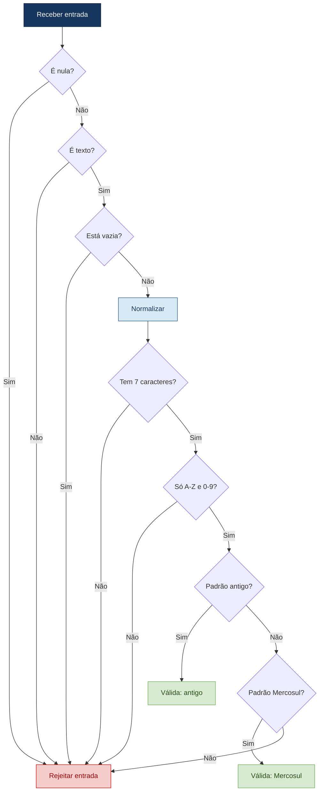
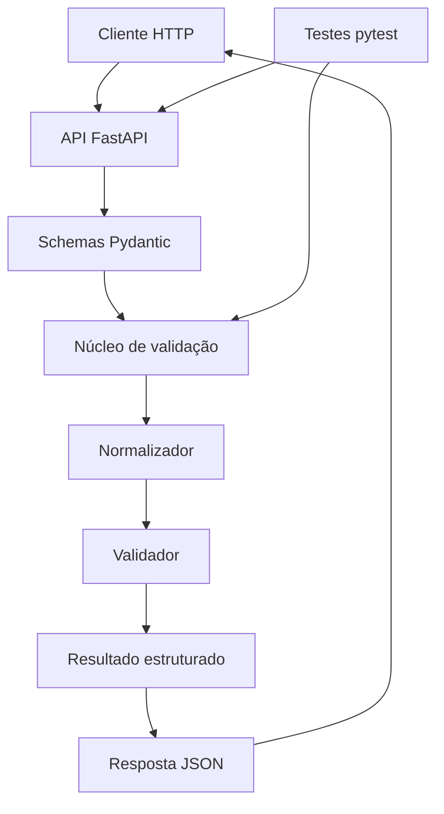
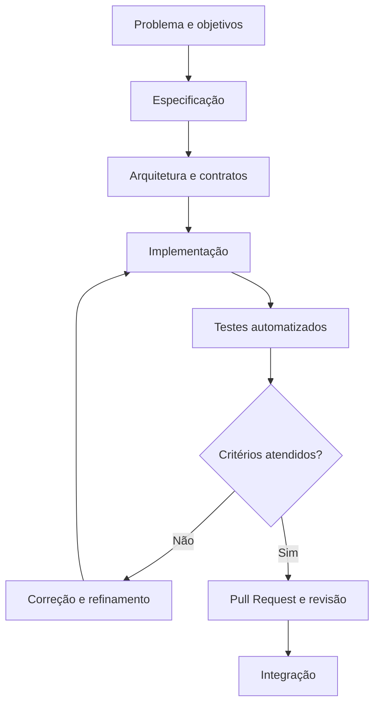

# BootCamp3

# Validador de Placas Brasileiras

API para validação de placas veiculares brasileiras nos padrões **antigo** e **Mercosul**, desenvolvida em Python com abordagem *Spec-Driven Development* (SDD).

## Integrantes

- **Adler Murga Ferreira** — RA: 22511624
- **Alexandre Henrique Paiva Rocha** — RA: 22451424
- **Arthur Gabriel da Silva Barbosa** — RA: 22500598
- **Gabriel Francisco Pires de Assis** — RA: 22408417
- **Jean de Almeida Brito** — RA: 22612228
- **José Rafael de Lucena Martini** — RA: 22610479

---

## 1. Visão geral

O Validador de Placas Brasileiras recebe uma placa informada pelo usuário, normaliza sua representação e verifica se ela corresponde a um dos formatos definidos na especificação do projeto.

São considerados dois padrões:

| Padrão | Exemplo |
|---|---|
| Antigo | `ABC-1234` |
| Mercosul | `ABC1D23` |

O sistema retorna um resultado estruturado com a validade da placa, sua representação normalizada, o padrão identificado e uma mensagem explicativa. Para entradas inválidas, informa o motivo da rejeição conforme as regras definidas.

O projeto utiliza **Spec-Driven Development (SDD)**, mantendo a especificação como referência para a arquitetura, implementação e testes automatizados.

## 2. Objetivos e escopo

### Funcionalidades implementadas

- Recebimento de placas por meio de uma API HTTP.
- Normalização de espaços externos e letras minúsculas.
- Aceitação do padrão antigo com ou sem hífen separador.
- Validação dos padrões antigo e Mercosul.
- Identificação do padrão reconhecido.
- Retorno estruturado para resultados válidos e inválidos.
- Identificação de motivos de rejeição.
- Validação do corpo da requisição e tratamento estruturado de erros.
- Endpoint de saúde da aplicação.
- Testes automatizados para o núcleo e a API.

### Fora do escopo

- Consulta de proprietários ou dados pessoais.
- Consulta de RENAVAM.
- Integração com DETRAN.
- Consulta a bancos de dados de veículos.
- Reconhecimento de placas por imagem ou câmera.

A validação verifica apenas a conformidade do texto informado com os formatos estabelecidos. Ela não comprova a existência ou a regularidade de um veículo.

## 3. Tecnologias utilizadas

- **Python** — linguagem de implementação.
- **FastAPI** — exposição das funcionalidades por API HTTP.
- **Pydantic** — validação dos dados recebidos pela API.
- **pytest** — execução dos testes automatizados.
- **Docker** — previsto para padronizar a execução do ambiente.
- **Git e GitHub** — controle de versão, colaboração e revisão de código.

## 4. Arquitetura

A aplicação separa as regras de negócio da camada HTTP. O núcleo de validação pode ser executado independentemente da API, facilitando testes, manutenção e evolução.

### Componentes principais

| Componente | Responsabilidade |
|---|---|
| `app/core/normalizador.py` | Normaliza a entrada conforme as regras definidas. |
| `app/core/resultado.py` | Define os tipos de resultado, padrões e motivos de rejeição. |
| `app/core/validador.py` | Aplica as regras de validação das placas. |
| `app/main.py` | Configura a aplicação FastAPI e seus endpoints. |
| `app/schemas.py` | Define os modelos de entrada e saída da API. |
| `tests/test_validator.py` | Testa o núcleo de normalização e validação. |
| `tests/test_api.py` | Testa os endpoints e os contratos HTTP. |

### Fluxo de validação




### Diagrama de arquitetura


    
## 5. Contrato da API

### `GET /`

Retorna informações básicas sobre a aplicação.

### `GET /health`

Verifica a disponibilidade da API.

Exemplo de resposta:

```json
{
  "status": "ok"
}
```

### `POST /validar`

Recebe uma placa para validação.

Exemplo de requisição:

```json
{
  "placa": "ABC-1234"
}
```

Exemplo de resposta para uma placa válida:

```json
{
  "valida": true,
  "placa_normalizada": "ABC1234",
  "padrao": "antigo",
  "motivo": null,
  "mensagem": "Placa válida no padrão antigo."
}
```

Exemplo de resposta para uma placa inválida:

```json
{
  "valida": false,
  "placa_normalizada": null,
  "padrao": null,
  "motivo": "CARACTERE_INVALIDO",
  "mensagem": "A placa contém caracteres não permitidos. Use apenas letras de A a Z e dígitos de 0 a 9."
}
```

Entradas inválidas do ponto de vista das regras de negócio retornam um resultado de validação. Requisições com corpo ou tipos de dados incompatíveis são tratadas como erros HTTP de validação.
 

## 6. Instalação e execução local

### Pré-requisitos

- Python 3.11 ou compatível com as dependências do projeto.
- Git.
- Terminal ou VS Code.

### Clonar o repositório

```bash
git clone https://github.com/0GabrielF0/BootCamp3.git
cd BootCamp3
```

### Criar um ambiente virtual

No Windows:

```powershell
python -m venv .venv
.venv\Scripts\Activate.ps1
```

### Instalar dependências

```powershell
python -m pip install -r requirements.txt
```

### Iniciar a API

```powershell
python -m uvicorn app.main:app --reload
```

Acesse no navegador:

- API e documentação: http://127.0.0.1:8000/docs
- Verificação de saúde: http://127.0.0.1:8000/health

Para encerrar o servidor, pressione `Ctrl + C` no terminal.

## 7. Execução dos testes

Com as dependências instaladas, execute:

```powershell
python -m pytest -v
```

Os testes verificam regras de normalização, formatos válidos e inválidos, motivos de rejeição, endpoints e tratamento de requisições.

**Resultado da última execução (2026-10-25):** 50 testes aprovados, 0 falhas, cobertura de 100% em `app/core`. Execução feita no mesmo ambiente do CI (contêiner `python:3.12-slim`) com:

```powershell
python -m pytest -v --cov=app.core --cov-report=term-missing
```

A meta de cobertura da especificação (≥ 90% no núcleo) foi atendida. O aviso de depreciação do Starlette sobre `httpx` no `TestClient` não afeta o resultado.

O pipeline do GitHub Actions ([`.github/workflows/tests.yml`](.github/workflows/tests.yml)) executa a mesma suíte a cada push e Pull Request em `main` e `develop`. Histórico: [Actions](https://github.com/0GabrielF0/BootCamp3/actions).

<details>
<summary>Log completo da execução</summary>

```text
============================= test session starts ==============================
platform linux -- Python 3.12.15, pytest-9.1.1, pluggy-1.7.0 -- /usr/local/bin/python
rootdir: /src
plugins: cov-7.1.0, anyio-4.15.1
collecting ... collected 50 items

tests/test_api.py::test_rota_inicial PASSED                              [  2%]
tests/test_api.py::test_health PASSED                                    [  4%]
tests/test_api.py::test_api_placa_antiga PASSED                          [  6%]
tests/test_api.py::test_api_placa_antiga_sem_hifen PASSED                [  8%]
tests/test_api.py::test_api_placa_mercosul PASSED                        [ 10%]
tests/test_api.py::test_api_placa_invalida PASSED                        [ 12%]
tests/test_api.py::test_api_formato_desconhecido PASSED                  [ 14%]
tests/test_api.py::test_api_campo_ausente PASSED                         [ 16%]
tests/test_api.py::test_api_tipo_incorreto PASSED                        [ 18%]
tests/test_api.py::test_api_rota_antiga_nao_existe PASSED                [ 20%]
tests/test_api.py::test_get_validar_metodo_nao_permitido PASSED          [ 22%]
tests/test_api.py::test_api_placa_curta_xxx PASSED                       [ 24%]
tests/test_api.py::test_api_campo_com_nome_errado PASSED                 [ 26%]
tests/test_api.py::test_api_corpo_nao_json PASSED                        [ 28%]
tests/test_validator.py::test_placas_validas[ABC-1234-ABC1234-antigo] PASSED [ 30%]
tests/test_validator.py::test_placas_validas[ABC1234-ABC1234-antigo] PASSED [ 32%]
tests/test_validator.py::test_placas_validas[ abc-1234 -ABC1234-antigo] PASSED [ 34%]
tests/test_validator.py::test_placas_validas[abc1234-ABC1234-antigo] PASSED [ 36%]
tests/test_validator.py::test_placas_validas[ABC1D23-ABC1D23-mercosul] PASSED [ 38%]
tests/test_validator.py::test_placas_validas[abc1d23-ABC1D23-mercosul] PASSED [ 40%]
tests/test_validator.py::test_placas_validas[ABC-1D23-ABC1D23-mercosul] PASSED [ 42%]
tests/test_validator.py::test_placas_validas[AAA0A00-AAA0A00-mercosul] PASSED [ 44%]
tests/test_validator.py::test_placas_validas[ZZZ9Z99-ZZZ9Z99-mercosul] PASSED [ 46%]
tests/test_validator.py::test_placas_validas[AAA-0000-AAA0000-antigo] PASSED [ 48%]
tests/test_validator.py::test_placas_validas[ZZZ-9999-ZZZ9999-antigo] PASSED [ 50%]
tests/test_validator.py::test_placas_invalidas[None-ENTRADA_NULA] PASSED [ 52%]
tests/test_validator.py::test_placas_invalidas[1234567-TIPO_INVALIDO] PASSED [ 54%]
tests/test_validator.py::test_placas_invalidas[entrada2-TIPO_INVALIDO] PASSED [ 56%]
tests/test_validator.py::test_placas_invalidas[-ENTRADA_VAZIA] PASSED    [ 58%]
tests/test_validator.py::test_placas_invalidas[   -ENTRADA_VAZIA] PASSED [ 60%]
tests/test_validator.py::test_placas_invalidas[ABC123-TAMANHO_INVALIDO] PASSED [ 62%]
tests/test_validator.py::test_placas_invalidas[ABC12345-TAMANHO_INVALIDO] PASSED [ 64%]
tests/test_validator.py::test_placas_invalidas[A-TAMANHO_INVALIDO] PASSED [ 66%]
tests/test_validator.py::test_placas_invalidas[ABC 1234-TAMANHO_INVALIDO] PASSED [ 68%]
tests/test_validator.py::test_placas_invalidas[AB-C-1234-TAMANHO_INVALIDO] PASSED [ 70%]
tests/test_validator.py::test_placas_invalidas[ABC!234-CARACTERE_INVALIDO] PASSED [ 72%]
tests/test_validator.py::test_placas_invalidas[\xc1BC1234-CARACTERE_INVALIDO] PASSED [ 74%]
tests/test_validator.py::test_placas_invalidas[AB\xc71234-CARACTERE_INVALIDO] PASSED [ 76%]
tests/test_validator.py::test_placas_invalidas[ABC_1234-TAMANHO_INVALIDO] PASSED [ 78%]
tests/test_validator.py::test_placas_invalidas[ABC12@4-CARACTERE_INVALIDO] PASSED [ 80%]
tests/test_validator.py::test_placas_invalidas[1234ABC-FORMATO_DESCONHECIDO] PASSED [ 82%]
tests/test_validator.py::test_placas_invalidas[ABCD123-FORMATO_DESCONHECIDO] PASSED [ 84%]
tests/test_validator.py::test_placas_invalidas[AB1C234-FORMATO_DESCONHECIDO] PASSED [ 86%]
tests/test_validator.py::test_placas_invalidas[ABCDEFG-FORMATO_DESCONHECIDO] PASSED [ 88%]
tests/test_validator.py::test_placas_invalidas[1234567-FORMATO_DESCONHECIDO] PASSED [ 90%]
tests/test_validator.py::test_placas_invalidas[ABC1DD3-FORMATO_DESCONHECIDO] PASSED [ 92%]
tests/test_validator.py::test_normalizador_remove_hifen_separador PASSED [ 94%]
tests/test_validator.py::test_normalizador_nao_remove_hifen_em_outra_posicao PASSED [ 96%]
tests/test_validator.py::test_normalizador_nao_remove_hifens_adicionais PASSED [ 98%]
tests/test_validator.py::test_nucleo_nao_depende_de_framework_web PASSED [100%]

=============================== warnings summary ===============================
../usr/local/lib/python3.12/site-packages/fastapi/testclient.py:1
  /usr/local/lib/python3.12/site-packages/fastapi/testclient.py:1: StarletteDeprecationWarning: Using `httpx` with `starlette.testclient` is deprecated; install `httpx2` instead.
    from starlette.testclient import TestClient as TestClient  # noqa

-- Docs: https://docs.pytest.org/en/stable/how-to/capture-warnings.html
================================ tests coverage ================================
_______________ coverage: platform linux, python 3.12.15-final-0 _______________

Name                       Stmts   Miss  Cover   Missing
--------------------------------------------------------
app/core/__init__.py           0      0   100%
app/core/normalizador.py       5      0   100%
app/core/resultado.py         19      0   100%
app/core/validador.py         25      0   100%
--------------------------------------------------------
TOTAL                         49      0   100%
======================== 50 passed, 1 warning in 7.38s =========================
```

</details>


## 8. Execução com Docker

O projeto prevê a padronização do ambiente por meio de Docker, de modo que a API possa ser executada de maneira reproduzível.

O `Dockerfile` usa `python:3.12-slim` (mesma versão do CI) e o `compose.yaml` publica a API na porta 8000. Para executar:

```powershell
docker compose up --build
```

A API fica disponível em `http://127.0.0.1:8000/docs`. Verificação feita em 2026-10-25:

```text
$ curl http://127.0.0.1:8000/health
{"status":"ok"}
$ curl -X POST http://127.0.0.1:8000/validar -H "Content-Type: application/json" -d '{"placa":"abc1d23"}'
{"valida":true,"placa_normalizada":"ABC1D23","padrao":"mercosul","motivo":null,"mensagem":"Placa válida no padrão Mercosul."}
```

Para rodar os testes no ambiente padronizado:

```powershell
docker run --rm -v "${PWD}:/src" -w /src python:3.12-slim sh -c "pip install -r requirements.txt && python -m pytest -v"
```


\1
Documentos do fluxo SDD:

- [`docs/spec.md`](docs/spec.md) — especificação técnica.
- [`docs/components.md`](docs/components.md) — decomposição em componentes.
- [`docs/spec-changelog.md`](docs/spec-changelog.md) — refinamentos da especificação.
- [`docs/refinamento-testes-erros-respecificacao.md`](docs/refinamento-testes-erros-respecificacao.md) — erros lógicos e loop de re-especificação.
- [`docs/relatorio-tecnico-etico.md`](docs/relatorio-tecnico-etico.md) — análise comparativa e ético-técnica do uso de IA.
- [`CLAUDE.md`](CLAUDE.md) / [`AGENTS.md`](AGENTS.md) — regras e contexto para os agentes de IA.

O desenvolvimento é orientado por especificações versionadas. As decisões de implementação estão alinhadas aos requisitos funcionais, não funcionais, regras de negócio e contratos documentados.

Fluxo adotado:



Documentos de referência do projeto:

- `docs/spec.md` — especificação funcional e regras de negócio.
- `docs/components.md` — arquitetura e responsabilidades dos componentes.
- `docs/spec-changelog.md` — histórico e justificativas das alterações na especificação.

As alterações nas especificações devem ser revisadas e versionadas, com registro do motivo da mudança e de seu impacto nos testes.

## 10. ADRs — Registros de Decisões Arquiteturais

Os ADRs (*Architecture Decision Records*) documentam as principais decisões técnicas, suas justificativas e consequências. Cada decisão fica versionada em um arquivo próprio em [`docs/adr/`](docs/adr/).

| ADR | Decisão | Status |
|---|---|---|
| [ADR-001](docs/adr/001-python-como-linguagem-principal.md) | Python como linguagem principal | Aceita |
| [ADR-002](docs/adr/002-fastapi-para-a-interface-http.md) | FastAPI para a interface HTTP | Aceita |
| [ADR-003](docs/adr/003-separacao-entre-nucleo-e-api.md) | Separação entre núcleo e API | Aceita |
| [ADR-004](docs/adr/004-expressoes-regulares-para-os-formatos-de-placas.md) | Expressões regulares para os formatos de placas | Aceita |
| [ADR-005](docs/adr/005-pytest-como-ferramenta-de-testes.md) | pytest como ferramenta de testes | Aceita |
| [ADR-006](docs/adr/006-git-com-branches-e-pull-requests.md) | Git com branches e Pull Requests | Aceita |
| [ADR-007](docs/adr/007-docker-para-padronizacao-do-ambiente.md) | Docker para padronização do ambiente | Aceita |

## 11. Controle de versão e colaboração

O projeto adota o fluxo:

```text
feature/* → develop → main
```

- **`main`:** versão principal e estável.
- **`develop`:** integração das funcionalidades aprovadas.
- **`feature/*`:** desenvolvimento de funcionalidades.

As contribuições devem ser feitas por branches e Pull Requests, com descrição das alterações e revisão por outro integrante. A branch `main` respeita as regras de proteção configuradas no repositório.

## 12. Relato de experiência do grupo

O desenvolvimento do projeto permitiu aplicar práticas de especificação, implementação incremental, testes automatizados e controle de versão colaborativo.

A abordagem SDD ajudou a transformar regras de negócio em comportamentos verificáveis, incluindo a normalização de entradas, a distinção entre os padrões de placas e a identificação estruturada de motivos de rejeição.

A separação do núcleo de validação da API favoreceu a organização do código e a testabilidade. Os testes também ajudaram a identificar e corrigir divergências entre o comportamento esperado e a implementação, incluindo o tratamento de métodos HTTP não permitidos.

O uso de Git e Pull Requests reforça a importância de preservar o histórico de alterações e revisar contribuições antes da integração. Durante o desenvolvimento, conflitos entre versões locais e remotas evidenciaram a necessidade de conferir o histórico das branches e resolver divergências cuidadosamente.

### Uso de inteligência artificial

A inteligência artificial foi utilizada como apoio à implementação, à revisão de código, à criação e correção de testes e à organização da documentação. As sugestões precisaram ser verificadas pela equipe por meio da leitura do código e da execução dos testes.

O uso de IA não substitui a responsabilidade dos integrantes pela correção, segurança e conformidade da solução com a especificação. As decisões técnicas e a aceitação das alterações continuam sob responsabilidade do grupo.

### Pontos de melhoria

- Abrir os próximos Pull Requests com base em `develop`, seguindo o fluxo definido no ADR-006.
- Manter a associação explícita entre testes e IDs de casos de teste (CT) da especificação.


## 13. Status do projeto

**Implementação e testes locais: funcionalidade principal implementada.**

- [x] Núcleo de normalização e validação.
- [x] API com endpoints principais.
- [x] Respostas estruturadas de validação.
- [x] Testes automatizados: 50 aprovados, cobertura de 100% no núcleo.
- [x] Pipeline de CI no GitHub Actions.
- [x] Execução com Docker Compose verificada.
- [x] ADRs em arquivos individuais ([`docs/adr/`](docs/adr/)).
- [x] Instruções para agentes de IA ([`CLAUDE.md`](CLAUDE.md), [`AGENTS.md`](AGENTS.md)).

---

**Projeto acadêmico — Validador de Placas Brasileiras**

Desenvolvido como atividade colaborativa de engenharia de software, com foco em especificação, arquitetura, testes automatizados, governança de código e uso responsável de ferramentas de inteligência artificial.
