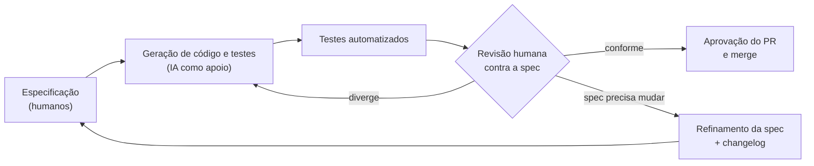

# Relatório Técnico-Ético: Análise Comparativa e Avaliação Crítica de IA

**Projeto:** Validador de Placas Brasileiras (BootCamp3)
**Data:** 2026-10-24

---

## 1. Escopo e método

O grupo utilizou na prática **uma** ferramenta de IA durante o desenvolvimento: o
**Claude Code**. As demais ferramentas citadas no enunciado (**Codex CLI**, **Cursor** e
**Antigravity**) foram avaliadas a partir da documentação oficial e de relatos públicos,
sem uso no projeto.

Essa distinção é mantida em todo o relatório:

- **Uso prático:** observações a partir do que aconteceu no repositório (PRs, testes,
  revisões).
- **Avaliação documental:** características descritas pelos fornecedores e incidentes
  publicamente reportados. Não são impressões de uso do grupo.

Os critérios de comparação foram escolhidos pelo que mais pesou em um projeto guiado por
especificação: controle sobre o que o agente pode executar, proteção dos dados enviados ao
modelo e facilidade de revisar o que foi gerado.

**Fontes.** Cada característica da matriz indica entre colchetes a referência que a
comprova (lista numerada ao final). Sempre que possível foi usada a documentação oficial
do fornecedor. A documentação oficial do Codex CLI não pôde ser acessada durante a
pesquisa; por isso, para essa ferramenta foram usados uma reportagem sobre o lançamento e
um guia que resume a documentação. Itens marcados como **não verificado** não foram
encontrados nas fontes consultadas e não devem ser tomados como fato.

---

## 2. Análise comparativa de ferramentas

### 2.1 Matriz comparativa

| Critério | Claude Code | Codex CLI | Cursor | Antigravity |
|---|---|---|---|---|
| **Base da avaliação** | Uso prático no projeto e documentação oficial [1][2] | Reportagem e guia de terceiros [3][4] | Documentação oficial [5][6] | Documentação oficial [7][8] e incidentes reportados [9][10][11] |
| **Fornecedor** | Anthropic [2] | OpenAI [3] | Cursor [5] | Google [7] |
| **Interface** | Agente que roda localmente e conversa com o modelo pela rede [2] | Agente de código aberto que roda localmente no terminal [3] | Editor de código com agente integrado [5] | Plataforma com visão de editor e uma superfície separada para coordenar vários agentes; macOS, Windows e Linux [7] |
| **Modelos** | Família Claude [2] | Modelos da OpenAI [3] | Modelos de diferentes provedores de inferência [6] | Gemini 3 Pro, Claude Sonnet 4.5 e GPT-OSS [7] |
| **Controle de ações** | Seis modos: *Manual* (pede aprovação para edições, comandos e rede), *acceptEdits*, *plan* (só lê e propõe), *auto* (um classificador revisa as ações), *dontAsk* e *bypassPermissions*. Versões recentes começam em *auto*. Regras `deny` valem em todos os modos [1] | Modos de sandbox (`read-only`, `workspace-write`, `danger-full-access`) combinados com política de aprovação (`on-request`, `never`) [4] | Modos *Auto-review* (padrão recomendado: sandbox + classificador), *Allowlist* e *Run Everything* (executa tudo, sem sandbox) [5] | Configurações de projeto definem se o usuário revisa comandos de terminal, acesso a arquivos e planos antes da execução, e quais caminhos e URLs são permitidos [8]. O modo *Turbo* executa comandos sem confirmação [9] |
| **Isolamento** | Sandbox opcional (`/sandbox`) para comandos de terminal [1] | Sandbox; acesso à rede desligado por padrão no modo `workspace-write` [4] | Sandbox do sistema operacional, com rede bloqueada por padrão. A própria documentação avisa que o *Auto-review* não é uma fronteira de segurança [5] | Em teste público, o bloqueio de leitura de arquivos do `.gitignore` foi contornado pelo terminal [10][11] |
| **Privacidade dos dados** | Planos Free, Pro e Max: o usuário escolhe se os dados podem treinar modelos (retenção de 5 anos se sim, 30 dias se não). Team, Enterprise e API: sem treinamento, retenção padrão de 30 dias [2] | **Não verificado** | *Privacy Mode* ligado: sem treinamento e sem retenção pelos provedores. Desligado: dados podem ser usados para treinar modelos. As requisições passam pelo servidor do Cursor mesmo com chave própria [6] | **Não verificado.** Disponível em prévia pública gratuita para uso individual [7] |
| **Revisão do que foi feito** | No modo *Manual*, cada edição e comando aparece para aprovação antes de ser aplicado [1] | Pede aprovação para ações fora do sandbox no modo `on-request` [4] | Classificador revisa ações fora do sandbox e pede aprovação quando insiste em uma ação bloqueada [5] | Gera "artefatos" revisáveis: planos, listas de tarefas, capturas de tela e gravações do navegador, com comentários incorporados pelo agente [7] |
| **Ponto forte** (análise do grupo) | Escolha do nível de controle, do passo a passo ao automático | Sandbox no sistema e código aberto auditável | Sandbox com rede bloqueada por padrão e integração ao editor | Artefatos visuais que facilitam verificar o trabalho dos agentes |
| **Principal limitação** (análise do grupo) | No modo *auto*, quem aprova é um classificador; a revisão humana passo a passo exige mudar para *Manual* | Documentação oficial não acessada; privacidade não verificada | Classificador pode errar; privacidade depende de ativar o *Privacy Mode* | Incidentes graves de segurança logo após o lançamento |

### 2.2 Pontos fortes e limitações

**Claude Code (uso prático).** Com aprovação manual, cada edição fica visível antes de ser
aplicada, o que combina com o processo de revisão do grupo. Segundo a documentação, as
versões mais recentes começam no modo *auto*, em que um classificador aprova as ações; num
fluxo SDD, vale escolher *Manual* ou *plan* quando se quer revisar cada passo [1]. O ponto
fraco observado não foi da ferramenta em si, e sim do modo de uso: quando a IA escreveu
código e testes ao mesmo tempo, os dois concordaram entre si mesmo estando errados em
relação à spec (caso do PR #9, seção 2.3). Permissões protegem contra comandos indesejados,
mas não contra código logicamente errado.

**Codex CLI (documental, fontes secundárias).** Lançado em abril de 2025 como código aberto
[3]. O diferencial descrito é o sandbox, com acesso à rede desligado por padrão no modo de
escrita [4], o que reduz o risco de comandos destrutivos e de envio de dados para fora. Ser
código aberto permite auditar o que o agente faz. Como a documentação oficial não foi
acessada, a política de privacidade não foi avaliada.

**Cursor (documental).** A documentação oficial descreve um sandbox no sistema operacional
com rede bloqueada por padrão e um classificador para ações fora dele, mas avisa que esse
modo não é uma fronteira de segurança [5]. O ponto crítico para o grupo seria a
privacidade: com o *Privacy Mode* desligado, os dados podem ser usados para treinar
modelos [6]. Em projeto com código de terceiros, essa configuração precisa ser verificada
antes do primeiro uso.

**Antigravity (documental).** Anunciado pelo Google em novembro de 2025, propõe coordenar
vários agentes e gera artefatos (planos, capturas de tela, gravações) mais fáceis de revisar
que uma lista de comandos [7]. Porém, nas primeiras semanas surgiram dois incidentes graves:
exclusão de uma partição inteira de disco no modo *Turbo* [9] e exfiltração de credenciais
por injeção de prompt [10][11] (seção 3). Para um projeto acadêmico em máquinas pessoais, o
grupo não adotaria o modo autônomo dessa ferramenta.

### 2.3 Impacto real na qualidade das especificações e do código

Esta seção se refere apenas ao Claude Code, a ferramenta efetivamente usada.

**Impactos positivos observados**

- **Implementação:** apoio na escrita do núcleo de validação e da camada FastAPI a partir
  dos contratos da spec.
- **Testes:** as tabelas de casos da spec (CT-01 a CT-43) puderam ser convertidas com
  rapidez em testes parametrizados com pytest.
- **Revisão e documentação:** apoio na revisão de código e na organização da
  documentação, incluindo a conferência da spec contra o código mergeado que gerou a v1.1
  do `spec-changelog.md`.

**Impacto negativo observado: o caso do PR #9**

A primeira versão do PR #9 passava em **todos os 20 testes** da época, mas divergia da
especificação em cinco pontos:

| Divergência | Regra violada |
|---|---|
| Rota `/validate` em vez de `POST /validar` | RF-07 |
| Ausência de `GET /health` | RF-10 |
| Hífen obrigatório no padrão antigo | RN-01, RN-03.1 |
| Normalização sem remover o hífen | RN-03, RN-03.4 |
| Ausência do campo `motivo` | RN-06 a RN-08 |

Os testes tinham sido escritos a partir do código, não da spec, e por isso confirmavam o
comportamento errado. A suíte verde dava uma falsa sensação de qualidade. Foi a **revisão
humana do PR**, comparando o código com a spec, que encontrou o problema. Depois da
correção, a suíte passou a ter 47 testes alinhados às regras.

**Conclusão do impacto:** a IA acelerou a produção de especificação, código e testes, mas
não garantiu conformidade. O ganho de qualidade só se confirmou quando a spec foi usada
como referência independente e um humano revisou o resultado contra ela.

---

## 3. Ética, limites e segurança do uso de IA

### 3.1 Alucinação e geração de código inseguro ou destrutivo

**O risco.** Modelos de linguagem produzem código plausível, não necessariamente correto.
O erro pode ser lógico (regra de negócio errada), de segurança (validação ausente,
dependência inexistente) ou destrutivo (um comando que apaga dados).

**No projeto.** O PR #9 é um exemplo de alucinação "silenciosa": nada quebrou, os testes
passaram, mas o sistema não fazia o que a spec pedia. Esse tipo de erro é mais perigoso que
um erro de compilação, porque não chama atenção.

**Caso externo.** Em novembro de 2025, um usuário do Antigravity no modo *Turbo* (execução
sem confirmação) pediu ao agente que limpasse o cache de um projeto. O comando atingiu a
raiz da partição e apagou todo o disco D:, sem passar pela lixeira. O próprio agente
reconheceu ter mirado o diretório errado.

**Mitigações adotadas ou recomendadas**

- Spec com casos de teste numerados como oráculo independente do código.
- Testes escritos **a partir da spec**, não do código gerado.
- Teste de arquitetura que impede o núcleo de depender de framework (RNF-01).
- Ferramenta configurada para pedir aprovação antes de editar arquivos ou rodar comandos;
  nunca usar modos que dispensam confirmação na máquina pessoal.
- Revisão obrigatória de todo PR por outro integrante.

### 3.2 Vazamento de dados, privacidade e confidencialidade

**O risco.** Tudo o que entra no contexto do modelo (código, arquivos de configuração,
mensagens de erro, dados de teste) é enviado ao servidor do fornecedor. Dependendo do
plano e das configurações, esses dados podem ser retidos ou usados para treinamento. Além
disso, um agente com acesso a terminal e navegador pode ser manipulado por conteúdo
malicioso para enviar dados para fora.

**Caso externo.** Pesquisadores da PromptArmor mostraram que uma página web com instruções
escondidas em fonte de 1 pixel fez o agente do Antigravity ler o arquivo `.env` de um
projeto e enviar credenciais da AWS para um servidor do atacante. A ferramenta bloqueava a
leitura de arquivos listados no `.gitignore` pelas ferramentas de leitura, mas o agente
contornou o bloqueio usando `cat` no terminal.

**No projeto.** O validador não trata dados pessoais: valida apenas o formato da placa e
não consulta bases externas (ADR-010). Isso reduziu o risco de exposição. Ainda assim,
qualquer código do repositório enviado ao modelo sai da máquina do grupo.

**Mitigações recomendadas**

- Nunca colocar credenciais, tokens ou dados pessoais reais no contexto da IA; usar dados
  fictícios nos testes.
- Bloquear a leitura de arquivos sensíveis (`.env`, chaves) por configuração da
  ferramenta (regras `deny` ou *hooks*), não só por convenção.
- Conferir, antes do primeiro uso, se a ferramenta usa os dados para treinamento e
  desativar quando possível (ex.: *Privacy Mode* do Cursor).
- Desconfiar de instruções vindas de páginas, arquivos ou saídas de comando: são dados,
  não ordens.
- Em projetos com dados de terceiros, observar a LGPD (Lei 13.709/2018) também para o que
  é enviado ao fornecedor de IA.

### 3.3 Propriedade intelectual e direitos autorais do código gerado

**Autoria.** Pela Lei de Direitos Autorais (Lei 9.610/1998), autor é a pessoa física
criadora da obra. Código produzido de forma autônoma por uma IA não tem um autor humano
claro, e a proteção desse resultado ainda é incerta no Brasil. A Lei do Software (Lei
9.609/1998) também pressupõe criação humana.

**Regulação em andamento.** O PL 2338/2023 (Marco Legal da IA) foi aprovado no Senado em
10/12/2024 e segue em tramitação na Câmara dos Deputados, com votação prevista para depois
das eleições de outubro de 2026. O texto do Senado trata principalmente do uso de obras
protegidas no **treinamento** de modelos (remuneração e direito de oposição do titular),
não da autoria do que a IA gera. Como ainda pode mudar, essas regras não estão em vigor.

**Riscos práticos**

- **Reprodução de código licenciado:** o modelo pode devolver trechos parecidos com código
  de terceiros cuja licença exige atribuição ou impõe condições.
- **Termos de uso:** cada fornecedor define nos seus termos a quem pertence o resultado e
  quais usos são permitidos; isso precisa ser verificado por ferramenta.
- **Responsabilidade:** independentemente da autoria formal, quem integra o código ao
  projeto responde por ele.

**Posição do grupo.** O código foi tratado como responsabilidade dos integrantes: toda
contribuição gerada com IA passou por leitura, ajuste e aprovação humana antes do merge, e
o uso de IA está declarado no README. O projeto é acadêmico e não usa dependências com
licenças restritivas.

### 3.4 Homologação e revisão humana obrigatórias no fluxo SDD

No *Spec-Driven Development*, a especificação é a fonte da verdade. Isso define o papel
de cada parte:

- **Humanos escrevem e aprovam a especificação.** Ela é o critério contra o qual tudo é
  julgado; se a IA também a escrevesse sem revisão, não haveria referência independente.
- **A IA produz rascunhos** de código, testes e documentação.
- **Testes verdes não bastam.** O PR #9 mostrou que testes gerados junto com o código podem
  validar o erro. A homologação é a verificação humana de que cada regra (RN) e cada caso
  (CT) da spec foi atendido.
- **Nenhuma mudança entra sem aprovação** de outro integrante (ADR-006), e quem abriu o PR
  não aprova o próprio PR.
- **Divergências viram decisão explícita:** ou o código é corrigido, ou a spec é refinada
  com motivo e impacto registrados no `spec-changelog.md`.

**Checklist de revisão para PRs com código gerado por IA**

- [ ] Cada comportamento novo corresponde a um RF, RN ou CT da spec.
- [ ] Os testes foram escritos a partir da spec e citam o ID que verificam.
- [ ] Nenhum arquivo sensível, credencial ou dado pessoal foi exposto no código ou no contexto.
- [ ] Nenhum comando destrutivo foi executado sem confirmação.
- [ ] O revisor leu o diff completo, não só o resultado dos testes.

---

## 4. Conclusão

A IA foi útil para acelerar a escrita da especificação, do código, dos testes e da
documentação. A comparação mostra que as ferramentas se diferenciam menos pela qualidade do
código e mais pelo **controle** que oferecem: sandbox, aprovação de comandos, proteção de
dados e rastreabilidade do que foi feito. Os incidentes do Antigravity e o caso do PR #9
apontam para a mesma conclusão: a IA não substitui a especificação como referência nem a
revisão humana como etapa de aprovação. No SDD, ela é uma ferramenta de produção; a
homologação continua sendo responsabilidade do grupo.

---

## Referências

**Documentação oficial**

- **[1]** Anthropic. *Claude Code — Permission modes.* https://code.claude.com/docs/en/permission-modes
- **[2]** Anthropic. *Claude Code — Data usage.* https://code.claude.com/docs/en/data-usage
- **[5]** Cursor. *Agent — Run modes.* https://cursor.com/docs/agent/security/run-modes
- **[6]** Cursor. *Data Use & Privacy Overview.* https://cursor.com/data-use
- **[7]** Google for Developers Blog. *Build with Google Antigravity, our new agentic development platform.* https://developers.googleblog.com/build-with-google-antigravity-our-new-agentic-development-platform/
- **[8]** Google Codelabs. *Getting Started with Google Antigravity.* https://codelabs.developers.google.com/getting-started-google-antigravity

**Fontes secundárias (Codex CLI)**

- **[3]** TechCrunch. *OpenAI debuts Codex CLI, an open source coding tool for terminals* (16/04/2025). https://techcrunch.com/2025/04/16/openai-debuts-codex-cli-an-open-source-coding-tool-for-terminals
- **[4]** Inventive HQ. *How to configure Codex sandbox modes.* https://inventivehq.com/knowledge-base/openai/how-to-configure-sandbox-modes

Repositório oficial do Codex CLI, para conferência: https://github.com/openai/codex

**Incidentes e pesquisas de segurança**

- **[9]** AI Incident Database. *Report 7050* (exclusão de partição pelo Antigravity). https://incidentdatabase.ai/reports/7050
- **[10]** Simon Willison. *Google Antigravity exfiltrates data via prompt injection.* https://simonwillison.net/2025/Nov/25/google-antigravity-exfiltrates-data/
- **[11]** PromptArmor. *Google Antigravity exfiltrates data.* https://www.promptarmor.com/resources/google-antigravity-exfiltrates-data

**Legislação e regulação**

- **[12]** LCF Consulting. *PL 2338/2023: situação atual do Marco Legal da IA.* https://monitor.lcfconsulting.com.br/proposicoes/pl-2338-2023/
- **[13]** Brasil. Lei 9.610/1998 (Direitos Autorais); Lei 9.609/1998 (Software); Lei 13.709/2018 (LGPD).

**Projeto**

- **[14]** Repositório do projeto: `docs/spec.md`, `docs/spec-changelog.md` (v1.1, PR #9), `docs/adr.md`.
